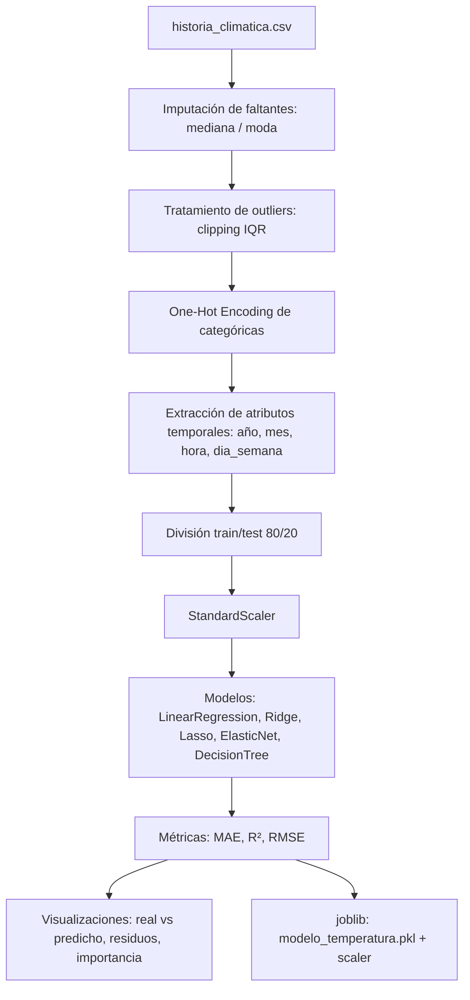

# grupal-regresion-lineal

Proyecto académico grupal sobre predicción de temperatura con modelos de regresión para el curso "Fundamentos del Machine Learning" (2025). Implementa y compara múltiples algoritmos de regresión sobre datos climáticos históricos.

[](https://python.org)
[](https://scikit-learn.org/)
[](https://github.com/bi0punk/grupal-regresion-lineal/actions)
[](LICENSE)

## Contenido

- [Características](#características)
- [Arquitectura](#arquitectura)
- [Stack](#stack)
- [Estructura del repositorio](#estructura-del-repositorio)
- [Instalación](#instalación)
- [Uso](#uso)
- [Datos](#datos)
- [Tests / CI](#tests--ci)
- [Limitaciones](#limitaciones)
- [Licencia](#licencia)

## Características

- Pipeline completo de regresión sobre datos climáticos históricos
- Comparación de múltiples modelos: regresión lineal, Ridge, Lasso, ElasticNet, árbol de decisión
- Imputación (mediana/moda), escalado (StandardScaler), división train/test
- Métricas: MAE, R², RMSE
- Visualización con matplotlib/seaborn
- Exportación de plantilla de entrada para el modelo y guardado de modelo (`joblib`)

## Arquitectura



## Stack

- **Lenguaje**: Python 3.12+
- **Entorno**: Jupyter Notebook
- **ML**: scikit-learn (modelos, preprocesamiento, métricas)
- **Datos**: pandas, numpy
- **Visualización**: matplotlib, seaborn
- **Calidad**: ruff (excluye `.ipynb`), pytest

## Estructura del repositorio

```
regresion-lineal/
├── DESARROLLO_Trabajo_Grupal_2025_v2.ipynb   # Notebook principal (entregable)
├── regression_analyzer.py                    # Análisis con modelos de regresión
├── historia_climatica.csv                    # Dataset (NO commiteado, ver Datos)
├── requirements.txt
├── pyproject.toml                            # config pytest + ruff
├── tests/test_smoke.py                       # smoke tests del notebook
├── .github/workflows/ci.yml
└── README.md
```

## Instalación

Requisitos: Python 3.12+ y Jupyter (para ejecutar el notebook).

```bash
python3 -m venv .venv
source .venv/bin/activate
pip install -r requirements.txt
```

## Uso

Coloca el dataset `historia_climatica.csv` en la raíz del repo (ver [Datos](#datos)) y abre el notebook:

```bash
jupyter notebook DESARROLLO_Trabajo_Grupal_2025_v2.ipynb
```

El notebook espera el CSV en el mismo directorio.

## Datos

El dataset `historia_climatica.csv` (~13MB, ~96k filas horarias de clima 2006–) **no se commitea** por tamaño. Se excluye vía `.gitignore`. Para reproducir:

- Consíguelo de la fuente original del curso, o
- Si ya lo tienes localmente, colócalo en la raíz del repo antes de abrir el notebook.

Columnas: `Summary, Precip Type, Temperature (C), Humidity, Wind Speed (km/h), Wind Bearing (degrees), Visibility (km), Loud Cover, Pressure (millibars), Daily Summary, Fecha`.

## Tests / CI

CI: GitHub Actions sobre Python 3.12:

- `ruff check .` (excluye `.ipynb` para no mutar el entregable académico)
- `pytest -q`

Los smoke tests (`tests/test_smoke.py`) validan estructura del notebook (JSON válido, celdas code+markdown), que el dataset no esté commiteado y que las deps figuren en `requirements.txt`. No ejecutan el notebook (pesa ~1.6MB con outputs).

```bash
pytest -q
```

## Limitaciones

- El notebook es el entregable académico; sus celdas no se auto-formatean ni se lintean para preservar outputs y flujo de ejecución
- Sin endpoint/servicio: es un análisis batch en notebook

## Licencia

MIT — ver [LICENSE](LICENSE).